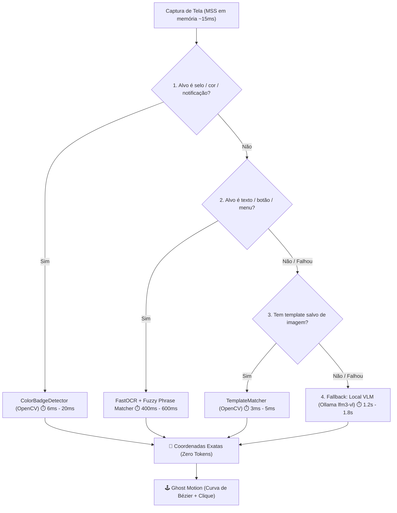

# 👻 GhostHand (Ghost-Hand)

> **Autonomous, Zero-Token Human-Like Desktop Operator & GUI Grounding Engine**  
> *Seamlessly compatible with **Google Antigravity (AGY)**, **Claude Code**, and **OpenCode**.*

---

## 🌟 O que é o GhostHand?

O **GhostHand** é uma ferramenta de automação e controle autônomo de desktop (mouse, teclado e tela) desenvolvida para agentes de IA que precisam operar interfaces reais (locais ou remotas via SSH/HTTP) com:

1. **Zero Tokens de Nuvem**: Todo o processamento visual (detecção de botões, selos, contadores e OCR) roda 100% localmente na máquina via visão computacional clássica (OpenCV + Tesseract) e modelos locais leves via Ollama (`lfm3-vl`, `moondream`, `qwen2-vl`).
2. **Movimentação Humana Natural**: Não anda em linhas retas robóticas que disparam anti-cheat ou bloqueios; usa curvas de Bézier cúbicas orgânicas, suavização de velocidade baseada na Lei de Fitts, micro-tremores e pausas de relaxamento muscular.
3. **Digitação Humanizada**: Simula a cadência real de um digitador humano, com variações gaussianas de atraso por tecla e pausas naturais em pontuações e quebras de pensamento.
4. **Pipeline Híbrido em Cascata (OmniParser Fast Cascade)**: Resolve cliques em textos e selos em **6ms a 600ms**, sem depender da latência pesada de Vision Transformers.
5. **Compatibilidade Total com Jogos (DirectX / DirectInput)**: Emulação de hardware scancodes para jogos modernos no Windows (ex: *SP Football Life*, *PES*, simuladores e títulos Unreal/Unity) que ignoram eventos Win32 tradicionais.

---

## 🏗️ Arquitetura em Cascata de Alta Fluidez

O GhostHand resolve o maior gargalo dos agentes de visão convencionais: **a latência de tela**.



---

## 🚀 Instalação & Setup Rápido

### 1. Dependências do Sistema

```bash
# macOS
brew install tesseract
pip install pyautogui pillow opencv-python mss

# Linux (Ubuntu/Debian)
sudo apt install tesseract-ocr
pip install pyautogui pillow opencv-python mss python-xlib

# Windows (para Bridge Remota ou Host)
pip install pyautogui pillow opencv-python mss pydirectinput
```

*(Opcional para visão semântica avançada):*
```bash
# Iniciar o Ollama com modelo de visão leve:
ollama run lfm3-vl
# ou
ollama run moondream
```

### 2. Disponibilidade Global na CLI

O GhostHand já está instalado em `~/.local/bin/ghosthand`:
```bash
ghosthand status
```

---

## 🤖 Compatibilidade Multi-Agente

### 🔹 1. Google Antigravity (AGY)
Localizado canonicamente em `~/.gemini/config/skills/ghosthand/`.
Qualquer agente Antigravity pode invocar:
```bash
ghosthand click --find "Não lidas" --human
```

### 🔹 2. Claude Code
Linkado em `~/.claude/skills/ghosthand/`.
O Claude Code descobre e executa a skill nativamente pelo arquivo `SKILL.md`.

### 🔹 3. OpenCode
Linkado em `~/.opencode/skills/ghosthand/`.
Totalmente operacional para fluxos de terminal e automação autônoma do OpenCode.

### 🔹 4. Model Context Protocol (MCP Server)
O GhostHand inclui um servidor MCP nativo (stdio JSON-RPC) com 11 ferramentas integradas. Isso permite usá-lo em **Claude Desktop**, **Cursor**, **Windsurf**, **Zed**, **Antigravity IDE** ou qualquer cliente MCP:

#### Iniciar via CLI:
```bash
ghosthand mcp
```

#### Configuração para Claude Desktop (`claude_desktop_config.json`):
```json
{
  "mcpServers": {
    "ghosthand": {
      "command": "ghosthand",
      "args": ["mcp"],
      "env": {
        "GHOSTHAND_TARGET": "local"
      }
    }
  }
}
```

#### Configuração para Cursor / Windsurf (`mcp.json`):
```json
{
  "mcpServers": {
    "ghosthand": {
      "command": "/Users/diegoaraujo/.local/bin/ghosthand",
      "args": ["mcp"]
    }
  }
}
```

#### Ferramentas MCP Expostas:
- `ghosthand_status`: Status da tela, ponte e visão local.
- `ghosthand_screenshot`: Captura de tela com controle de escala/qualidade.
- `ghosthand_find`: Localização visual rápida em cascata (Color -> OCR -> Template -> VLM).
- `ghosthand_click`: Clique em coordenadas ou busca visual com modo humano (`human: true`).
- `ghosthand_move`: Movimento em curva de Bézier cúbica com amortecimento de velocidade.
- `ghosthand_type`: Digitação com cadência humana (WPM) e pausas pontuais.
- `ghosthand_press`: Atalhos de teclado (`enter`, `ctrl+c`, `command+space`, etc.).
- `ghosthand_hold`: Segurar teclas por tempo (jogos / DirectInput).
- `ghosthand_drag`: Arrastar mouse de ponto A para ponto B.
- `ghosthand_scroll`: Rolagem da roda do mouse.
- `ghosthand_macro`: Execução de sequência de comandos em lote.

---

## 🕹️ Guia de Uso da CLI

### 1. Verificar Status e Conexão
```bash
ghosthand status
```

### 2. Captura de Tela
```bash
# Captura tela local instantaneamente (< 20ms)
ghosthand screenshot --out /tmp/tela.jpg
```

### 3. Localização Visual Inteligente (Zero Tokens)
```bash
# Busca automática (escolhe a rota mais rápida em cascata)
ghosthand find "Não lidas"

# Forçar OCR direto em textos e menus (< 500ms)
ghosthand find "Pesquisar" --strategy ocr

# Forçar detecção de selo de notificação (< 15ms)
ghosthand find "selo verde" --strategy color
```

### 4. Cliques e Movimentação Humanizada
```bash
# Localiza e clica com movimento orgânico de mão humana
ghosthand click --find "Não lidas" --human

# Clica em coordenadas fixas (instantâneo)
ghosthand click --x 500 --y 300

# Clica em coordenadas com curva de Bézier e pausa natural
ghosthand click --x 500 --y 300 --human

# Apenas desliza o cursor suavemente pela tela
ghosthand move --x 800 --y 450 --human --duration 1.2
```

### 5. Digitação Natural
```bash
# Digita com cadência humana, pausas em pontuações e variação de velocidade (60 WPM)
ghosthand type "Olá! Esta é uma demonstração de digitação humana." --human --wpm 60
```

### 6. Atalhos e Teclado
```bash
ghosthand press enter
ghosthand press "ctrl+c"
ghosthand press "command+space"

# Segurar tecla por tempo determinado (ideal para jogos e movimentação)
ghosthand hold w --duration 2.0
```

---

## 🌐 Controle Remoto Windows (Bridge Agent)

Para operar uma máquina Windows remotamente (ex: PC gamer rodando *SP Football Life 2027* no IP `192.168.31.231`):

### No Windows:
Execute o servidor bridge leve (pure Python HTTP):
```cmd
python ~/.gemini/config/skills/ghosthand/scripts/bridge_agent.py --server --port 8788
```

### No Mac / Linux / Agente:
Basta apontar `--target`:
```bash
# Ver status remoto do Windows
ghosthand --target http://192.168.31.231:8788 status

# Tirar print remoto da tela do jogo
ghosthand --target http://192.168.31.231:8788 screenshot --out /tmp/game.jpg

# Pressionar teclas via DirectInput (hardware scancodes sem bloqueio)
ghosthand --target http://192.168.31.231:8788 press enter
ghosthand --target http://192.168.31.231:8788 hold w --duration 1.5
```

---

## 📊 Benchmarks de Desempenho

| Operação | Método | Latência | Custo em Tokens de Nuvem |
| :--- | :--- | :--- | :--- |
| **Detecção de Selo/Badge** | OpenCV Masking | **~6ms** | **0 tokens** |
| **Template Match** | OpenCV TM_CCOEFF | **~4ms** | **0 tokens** |
| **Localização de Texto** | Tesseract + Fuzzy Phrase | **~500ms** | **0 tokens** |
| **Visão Semântica** | Ollama `lfm3-vl` Local | **~1.5s** | **0 tokens** |
| **Movimento de Mouse** | Cubic Bézier Curve (60 FPS) | **~0.8s - 1.2s** | **0 tokens** |

---

## 📄 Licença
Distribuído sob a licença MIT. Livre para uso pessoal, comercial e em agentes autônomos.
